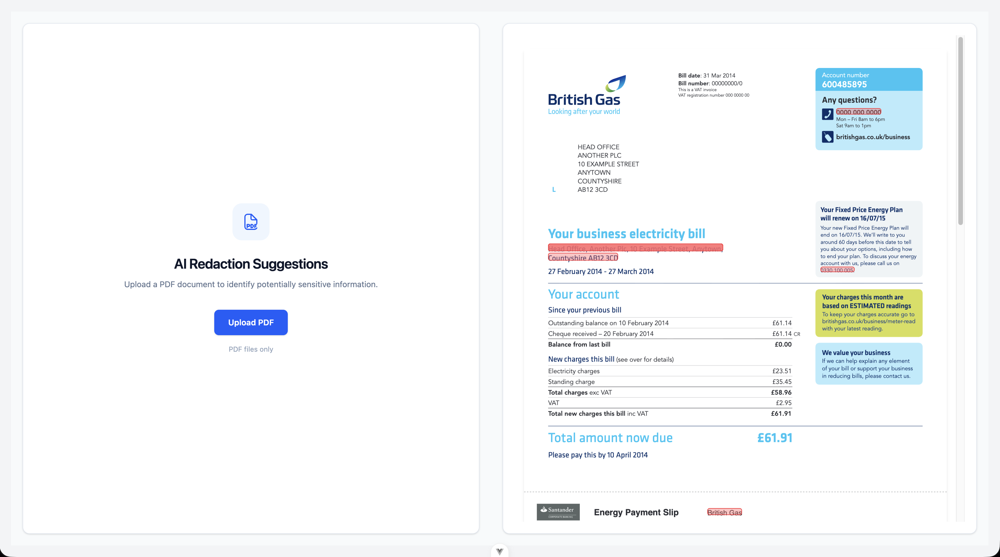
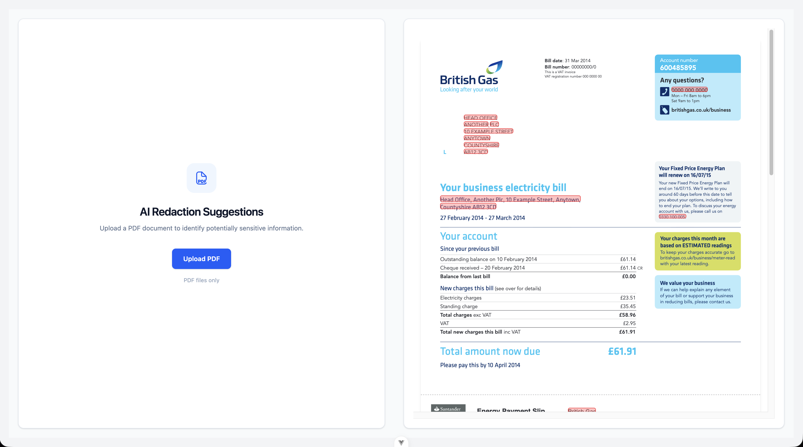
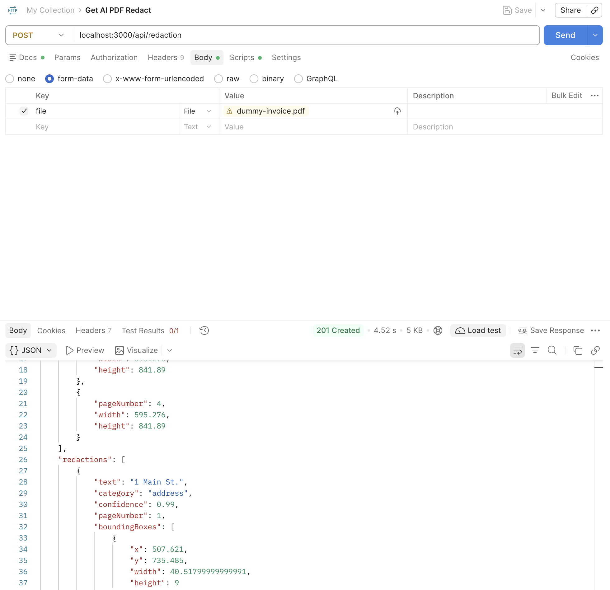
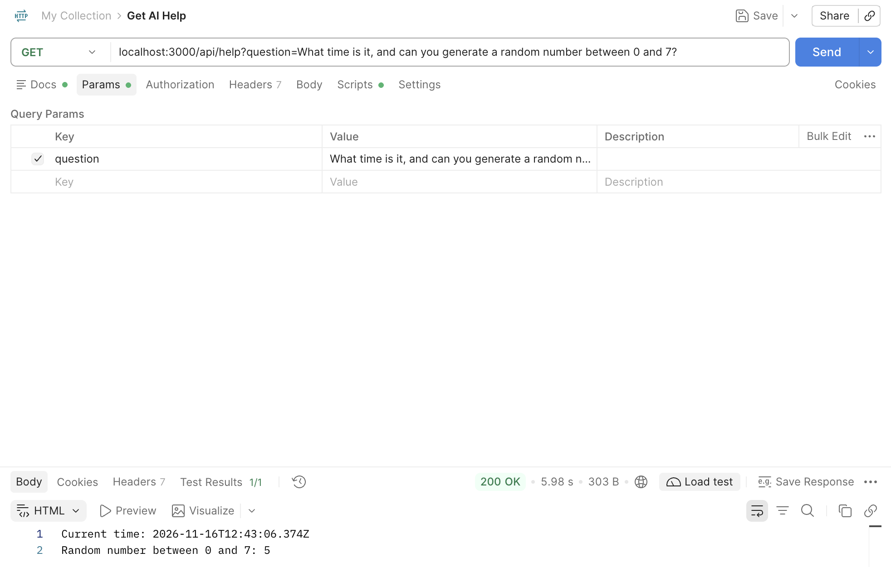

# AI Practice Projects

This repository contains two small projects built to expand my knowledge of working with AI APIs during redundancy. They aren't intended to represent production-level code, 
so expect to see shortcuts, heavy commenting, and plenty of TODOs!

The main focus is understanding how AI tool calls work, how to validate and execute model requests, and how to combine an AI model with conventional application code.

## PDF Redaction

The PDF redaction project is a NestJS API and Vue frontend that attempts to identify sensitive information in a PDF.

The workflow is:

1. Upload a PDF.
2. Extract its pages and text using PDF.js.
3. Ask the AI to identify likely sensitive values.
4. Match those values against the original PDF text.
5. Return the page numbers and text positions to the frontend.
6. Display each match as a redaction highlight in the PDF viewer.

I use Zod schemas to keep AI responses structured and predictable. I also avoid trusting the AI to provide final coordinates, I search the extracted PDF content and calculate 
the bounding boxes myself.  There are some inefficiencies in this but its primarily a side effect of providing the AI engineered prompt with a text representation of the PDF
rather than serialised payload of PDF elements from PDF.js.  AI seems to work better with structured text rather than a massive overload of JSON data, I could make this marrying 
up of AI suggested redactions to real PDF text elements more efficient using a lookup dictionary of sorts, rather than looping the earth.

This project was built as a learning exercise, but it demonstrates several useful ideas:

- Building an agent-style tool-calling loop.
- Giving an AI model access to typed, registered tools.
- Validating model output instead of treating it as trusted data.
- Converting PDF documents into text that a model can understand.
- Matching AI-generated text back to real document elements.
- Rendering PDF pages and overlays in a Vue application.
- Keeping PDF, redaction, and AI responsibilities in separate services.







## AI Tool Calling

The shared `ai.common` package contains the agent implementation.

My AI Agent Service sends a question and instructions to OpenAI, creates tool definitions from the local tool registry, and handles function calls returned by the model. When the model 
requests a tool, I then:

1. Checks that the tool exists.
2. Validates its arguments (using Zod, via schemas provided to the call, come to me supermaaaaaaaaaaaaan).
3. Executes the registered function.
4. Send the result back to the model.
5. Repeats the process until the model produces a final response (e.g. my implementation of an Agent Loop).

The tool-calling implementation is deliberately simple enough to understand while demonstrating the complete loop, the tools themselves Mickey Mouse Clubhouse simples.



## Running the Projects

The repository contains separate frontend and API packages, plus shared TypeScript packages.

Create a local `.env` file for each API that requires OpenAI access:

```text
OPENAI_API_KEY=your_api_key
```

Environment files are ignored by Git and should never be committed.

Install dependencies and start the relevant package using its local package scripts.

## Current Limitations

- PDF support is currently limited to native PDF text.
- Scanned PDFs would require OCR, this is available with AI but was more costly.
- Bounding-box handling does not yet cover every possible text rotation or skew.
- AI results are probabilistic and I should be review the `confidence` score and exclude anything below 50%.  I also think a good improvement would be to use different
  coloured bounding box overlays on the PDF based on the score, e.g. yellow for 50-70% score and red for > 70%.  Currently they are all read, regardless.
- Tool calls and AI responses should receive the same care and validation as any other external API input.

## Technologies

- TypeScript
- NestJS
- Vue
- OpenAI Responses API
- Zod
- PDF.js
- npm workspaces
